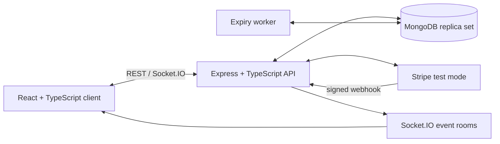

# SeatLock — Client Build Blueprint

**Project type:** Full-stack MERN application using TypeScript  
**Working title:** SeatLock  
**Client brief:** Build a real-time event ticketing platform where customers can choose a specific seat, temporarily lock it during checkout, and receive a confirmed ticket only after successful payment. The system must prevent two customers from buying the same seat, even when they click at almost the same time.

---

## 1. Project vision

SeatLock will make reserved-seat event booking clear, fast, and reliable. Customers should be able to discover an event, view its seat map, select seats, see their price, complete checkout, and receive a booking confirmation. Event organizers should be able to create events, define venues and seats, publish events, and monitor bookings.

The technical objective is to demonstrate a production-minded MERN application: role-based access control, real-time updates, reliable payment flow, transactional database operations, and a concurrency-safe inventory model.

### Success statement

For a published event, a customer can reserve available seats for a short checkout window, pay for them, and receive a booking. At no time can two confirmed bookings contain the same event seat.

---

## 2. User roles

| Role | Purpose | Main permissions |
| --- | --- | --- |
| Guest | Browse before creating an account | Browse/search published events, view seat maps, register and sign in |
| Customer | Buy tickets | Reserve seats, start checkout, pay, view/cancel eligible bookings, download ticket/QR code |
| Organizer | Manage their events | Create venues, seat layouts, events, ticket tiers; publish/unpublish events; view orders and sales summary |
| Admin | Platform management | Manage users/events, moderate published content, view all bookings, resolve support issues |

An organizer may also be a customer, but their organizer actions must be protected by the organizer/admin role.

---

## 3. Scope

### Required MVP

- Account registration, sign-in, sign-out, and role-based authorization.
- Public event listing, filters, event detail page, and venue seat map.
- Organizer dashboard to create a venue, define seats, create an event, and publish it.
- Per-event seat availability with `available`, `held`, `booked`, and `blocked` states.
- Temporary multi-seat hold for checkout, with a visible countdown (for example, 10 minutes).
- Atomic seat holding so only one concurrent request can hold a seat.
- Checkout using a payment provider test mode (Stripe is recommended).
- Payment webhook handling that creates the confirmed booking exactly once.
- Real-time seat-map updates through Socket.IO when seats are held, released, booked, or blocked.
- Customer booking history and ticket confirmation page with a QR code or unique booking reference.
- Automated tests, including simultaneous booking attempts for the same seat.

### Out of scope for version 1

- Live ticket resale/marketplace, dynamic pricing, waitlists, loyalty points, coupons, gift cards, and multi-currency settlement.
- Real card data storage; all payment data stays with the payment provider.
- Native iOS/Android applications.
- Complex venue drawing tools. Start with a grid/section based seat-layout editor.
- Refund automation. Record cancellation/refund status manually in the MVP if needed.
- Multi-tenant billing for organizers.

---

## 4. Key user flows

### A. Customer buys seats

1. Customer signs in and opens a published event.
2. Client loads the event seat map and current seat states.
3. Customer selects one or more available seats.
4. Client calls the hold API with the selected seat IDs and an idempotency key.
5. Server atomically changes only available event seats to `held`, assigns a hold token, and returns an expiry time.
6. All connected viewers receive a real-time update and see those seats as unavailable.
7. Customer starts payment before the hold expires.
8. Payment provider confirms payment and sends a signed webhook.
9. Server verifies the webhook, changes the held seats to `booked`, creates one booking, and broadcasts the update.
10. Customer sees confirmation and can view/download the ticket.

### B. Hold expires

1. A hold reaches `expiresAt` without a successful payment.
2. A background worker releases its held seats only if they still belong to that hold.
3. The system broadcasts that the seats are available again.
4. The customer sees that their hold expired and must select seats again.

### C. Organizer publishes an event

1. Organizer creates or selects a venue with named sections, rows, and seats.
2. Organizer creates an event, chooses start/end time, ticket prices, and venue.
3. Server generates an `EventSeat` document for every venue seat.
4. Organizer publishes the event after validation.
5. Guests can now find the event and see its seat map.

---

## 5. Functional requirements

### Accounts and access

- Users can register with name, email, and password.
- Email addresses are unique and normalized to lowercase.
- Customers can sign in, refresh an expired access session, and sign out.
- Protected routes enforce authenticated user and role requirements on the server.
- An organizer can edit only events and venues they own; admins can access all records.

### Events and venues

- Events contain title, description, poster URL, category, venue, start/end time, sale window, and publish status.
- Events cannot be published without a future start time, venue, and at least one sellable seat/ticket price.
- Venue seats have stable labels such as `A-01`, section, row, number, type, and accessibility metadata.
- An event stores a price snapshot for each event seat so later venue changes do not change sold ticket details.

### Seat map and booking

- The seat map distinguishes available, held, booked, and blocked seats without exposing another customer’s identity.
- Customers can hold between 1 and a configured maximum number of seats (for example, 8).
- A hold contains a random, unguessable token and expiry time.
- Seats are never confirmed by the client alone; the server verifies the active hold and payment result.
- A booking is immutable once paid, except for controlled status changes such as cancellation or refund.

### Notifications and reporting

- Show on-screen confirmation after a successful booking.
- Send a transactional email when a booking is confirmed if email delivery is included.
- Organizer dashboard shows event booking count, seats sold, gross revenue, and remaining seats.

---

## 6. Data model (MongoDB / Mongoose)

Use `ObjectId` references and TypeScript interfaces/schemas. Store money in the smallest currency unit (for example, paisa/cents) as an integer.

### User

```ts
{
  _id, name, email, passwordHash,
  role: 'customer' | 'organizer' | 'admin',
  createdAt, updatedAt
}
```

Indexes: unique index on `email`.

### Venue

```ts
{
  _id, organizerId, name, address, city,
  layoutVersion,
  seats: [{ seatId, section, row, number, label, x, y, type, isAccessible }],
  createdAt, updatedAt
}
```

`seatId` is a stable ID inside a venue. `x` and `y` allow the client to render a grid map.

### Event

```ts
{
  _id, organizerId, venueId, title, slug, description, category, posterUrl,
  startsAt, endsAt, salesStartAt, salesEndAt,
  status: 'draft' | 'published' | 'cancelled' | 'completed',
  currency: 'PKR', createdAt, updatedAt
}
```

Indexes: unique `slug`, plus `{ status: 1, startsAt: 1 }` for public listings.

### EventSeat (the inventory source of truth)

Create one document per venue seat per event.

```ts
{
  _id, eventId, venueSeatId, section, row, number, label, type,
  price: 250000, // smallest currency unit
  state: 'available' | 'held' | 'booked' | 'blocked',
  holdId: ObjectId | null,
  holdTokenHash: string | null,
  holdExpiresAt: Date | null,
  bookingId: ObjectId | null,
  version: number,
  createdAt, updatedAt
}
```

Critical index: **unique compound index on `{ eventId: 1, venueSeatId: 1 }`**. This guarantees only one inventory record exists for each seat at each event. Add `{ eventId: 1, state: 1, holdExpiresAt: 1 }` to support seat-map reads and release jobs.

### SeatHold

```ts
{
  _id, eventId, customerId, seatIds: ObjectId[],
  tokenHash, status: 'active' | 'expired' | 'converted' | 'released',
  expiresAt, idempotencyKey, createdAt, updatedAt
}
```

Indexes: unique `{ customerId: 1, idempotencyKey: 1 }`; index `{ status: 1, expiresAt: 1 }`.

### Booking

```ts
{
  _id, reference, eventId, customerId, holdId,
  seats: [{ eventSeatId, label, price }],
  amount, currency,
  status: 'pending_payment' | 'confirmed' | 'cancelled' | 'refunded' | 'payment_failed',
  paymentProvider, paymentIntentId, confirmedAt,
  createdAt, updatedAt
}
```

Indexes: unique `reference`, sparse unique `paymentIntentId`, `{ customerId: 1, createdAt: -1 }`.

### PaymentEvent (webhook idempotency)

```ts
{ _id, providerEventId, type, receivedAt, processedAt, status }
```

Index: unique `providerEventId`.

---

## 7. API contract

Base path: `/api/v1`. All error responses use:

```json
{ "error": { "code": "SEAT_UNAVAILABLE", "message": "One or more seats are no longer available.", "details": {} } }
```

| Method and path | Auth | Purpose |
| --- | --- | --- |
| `POST /auth/register` | Public | Create customer account |
| `POST /auth/login` | Public | Create session / issue tokens |
| `POST /auth/refresh` | Refresh cookie | Refresh access token |
| `POST /auth/logout` | User | Revoke current refresh session |
| `GET /events` | Public | Search/filter published events |
| `GET /events/:slug` | Public | Event details |
| `GET /events/:eventId/seats` | Public | Seat map and current states |
| `POST /events/:eventId/holds` | Customer | Atomically create seat hold |
| `DELETE /holds/:holdId` | Hold owner | Release an active hold early |
| `POST /holds/:holdId/checkout` | Hold owner | Create payment intent/session |
| `GET /bookings/me` | Customer | Customer booking history |
| `GET /bookings/:reference` | Booking owner/Admin | Booking/ticket details |
| `POST /organizer/venues` | Organizer/Admin | Create venue |
| `POST /organizer/events` | Organizer/Admin | Create draft event and event seats |
| `PATCH /organizer/events/:eventId` | Owner/Admin | Edit event |
| `POST /organizer/events/:eventId/publish` | Owner/Admin | Publish event |
| `POST /payments/webhook` | Provider only | Receive verified payment event |

### Create hold request

`POST /events/:eventId/holds`

```json
{
  "seatIds": ["eventSeatObjectId1", "eventSeatObjectId2"],
  "idempotencyKey": "a-new-uuid-per-user-action"
}
```

Success (`201`):

```json
{
  "hold": {
    "id": "holdObjectId",
    "expiresAt": "2026-10-10T12:10:00.000Z",
    "seats": [{ "id": "eventSeatObjectId1", "label": "A-01", "price": 250000 }],
    "total": 250000,
    "currency": "PKR"
  }
}
```

Return `409 SEAT_UNAVAILABLE` if any requested seat cannot be held. The operation must not partially hold the requested list.

---

## 8. Atomic, concurrency-safe reservation design

This is the most important part of the project. Never use a read-then-write pattern such as “fetch seat, check it is available, then update it” outside a transaction. Two requests can read the same available seat before either writes.

### Required approach

Use a MongoDB replica set (MongoDB Atlas supports this) and a Mongoose transaction. Within one transaction:

1. Validate authentication, event sale window, number of seat IDs, and that IDs are unique.
2. Return the existing active hold if the same `(customerId, idempotencyKey)` already completed.
3. Create a `SeatHold` with an expiry (`now + 10 minutes`) and a cryptographically random raw token. Store only a hash of the raw token.
4. Run one conditional `updateMany` on `EventSeat`:

   ```ts
   const result = await EventSeat.updateMany(
     {
       _id: { $in: seatIds },
       eventId,
       $or: [
         { state: 'available' },
         { state: 'held', holdExpiresAt: { $lte: now } }
       ]
     },
     {
       $set: {
         state: 'held', holdId, holdTokenHash, holdExpiresAt: expiresAt
       },
       $inc: { version: 1 }
     },
     { session }
   );
   ```

5. Require `result.modifiedCount === seatIds.length`. If it differs, throw an error so the transaction aborts and no seat changes persist.
6. Read the updated seats in the same session, write their IDs to the hold, and commit.
7. Only after commit, emit a Socket.IO seat-state event.

### Why this prevents double booking

The conditional update accepts a seat only when it is available or its old hold has expired. MongoDB applies the update atomically per document, and the transaction makes the multi-seat request all-or-nothing. A competing request finds the seat no longer eligible and receives `409`.

### Payment confirmation transaction

On a verified successful payment webhook, start another transaction:

1. Insert `PaymentEvent` with the provider event ID. If it already exists, return success without repeating work.
2. Find the target hold and verify it is active, owned by the intended customer, and not expired.
3. Update all hold seats only when `state: 'held'` and `holdId` matches. Require every held seat to update.
4. Create the `Booking` with a unique reference and the server-side price snapshot.
5. Mark the hold `converted`, link seats to the booking, and commit.
6. Emit `seats:booked` after commit.

Do not trust a `paymentSuccess` request from the browser. Only a signed payment-provider webhook can confirm a booking.

---

## 9. Expiry and real-time updates

### Hold expiry

- Use `holdExpiresAt` on `EventSeat` as the definitive availability rule.
- Run a worker every 30–60 seconds to find expired active holds and update only seats whose `holdId` matches that hold and expiry is in the past.
- Mark those holds `expired`; set affected seats to `available` and clear hold fields in a transaction.
- A MongoDB TTL index may delete old `SeatHold` documents later, but must **not** be the release mechanism because TTL deletion timing is not exact and it does not update related seats.
- On each seat-map read and hold attempt, treat an expired `held` seat as reclaimable even if the worker has not run yet.

### Socket.IO events

Clients join room `event:<eventId>` after loading an event. Broadcast only state changes, never hold tokens or customer details.

```ts
// Server → clients in event room
'seats:changed' // { eventId, seats: [{ id, state, holdExpiresAt? }] }
'event:status-changed' // { eventId, status }
```

The client applies small updates immediately and refetches the full seat map after reconnecting, receiving an out-of-order event, or a failed hold response.

---

## 10. Authentication and security requirements

- Hash passwords with Argon2id or bcrypt (use an appropriate work factor); never store plain passwords.
- Use short-lived access tokens and rotating refresh tokens in `HttpOnly`, `Secure`, `SameSite` cookies. Store a hash of each refresh token/server session for revocation.
- Validate request bodies with Zod or Joi; reject unknown or malformed IDs, dates, and enum values.
- Enforce authorization in server middleware and again in service methods for sensitive actions.
- Configure CORS with the known frontend origin, rate-limit authentication and hold endpoints, and use Helmet/security headers.
- Use HTTPS in deployment, environment variables for secrets, and separate test keys for payment.
- Verify payment webhook signatures against the raw request body.
- Do not expose password hashes, refresh tokens, provider secrets, raw hold tokens, or other customers’ personal data.
- Log audit events for publish/unpublish, manual seat blocks, booking status changes, and payment webhook errors.
- Apply a content-security policy and sanitize any rich event descriptions if HTML is supported.

---

## 11. Architecture



### Recommended repository structure

```text
seatlock/
  client/                 # React, Vite, TypeScript, TanStack Query, Socket.IO client
  server/
    src/
      config/             # environment validation
      modules/            # auth, events, venues, seats, holds, bookings, payments
      middleware/         # auth, roles, validation, errors, rate limits
      jobs/               # expired-hold worker
      sockets/            # room join and event emitters
      tests/              # unit, integration, concurrency tests
```

Use a controller → service → repository/model structure. Put transactional booking logic in services, never in HTTP controllers.

---

## 12. Test plan

### Unit tests

- Price calculation, booking reference generator, hold-token hashing, and expiry checks.
- Validation schemas and role/ownership guards.
- Seat state transition rules.

### Integration tests

- Registration/login, protected endpoint access, organizer ownership, and public event filtering.
- Create event generates exactly one `EventSeat` per venue seat.
- Hold request succeeds for available seats and fails for blocked/booked seats.
- Multi-seat hold is all-or-nothing when one requested seat is unavailable.
- Hold expiry worker releases only the correct expired seats.
- Signed webhook creates one booking; replaying the same webhook does not create a second booking.
- A confirmed booking remains confirmed when an expired-hold job later runs.

### Required concurrency test

1. Create one event with one available seat.
2. Simultaneously send 20 authenticated hold requests for that same seat, using different users and idempotency keys.
3. Assert exactly one request returns `201` and the other 19 return `409`.
4. Assert the database has exactly one active hold linked to that seat.
5. Confirm the winning hold through a mocked verified payment webhook.
6. Repeat simultaneous confirmation/replay attempts and assert exactly one confirmed booking exists and the seat is `booked`.

Run integration tests against a MongoDB replica set/test container, because standalone MongoDB does not support production-like transactions.

---

## 13. Delivery plan (6 weeks)

| Week | Deliverable | Definition of done |
| --- | --- | --- |
| 1 | Foundation | Monorepo, TypeScript, linting, env validation, MongoDB connection, auth, roles, base React layout, CI |
| 2 | Organizer/event management | Venue seat-grid editor, event CRUD, publish validation, public event list/detail pages |
| 3 | Seat map and holds | EventSeat generation, visual seat map, transactional hold API, countdown, release worker, Socket.IO updates |
| 4 | Checkout and booking | Stripe test checkout/payment intent, signed webhook, confirmed booking/ticket page, booking history |
| 5 | Quality and security | Integration/concurrency tests, authorization review, rate limits, error handling, responsive/accessibility pass |
| 6 | Polish and demo | Organizer reporting, seed data, deployment, README, screenshots/video, bug fixes |

If only four weeks are available, combine weeks 1–2 and weeks 5–6; keep transactional holds, webhook verification, and concurrency tests mandatory.

---

## 14. Acceptance criteria

The client accepts the MVP when all of the following are demonstrable:

- A customer can register, log in, browse published events, and see a seat map.
- An organizer can create a venue, event, and publish it with seats and prices.
- Selecting seats creates a visible hold with an expiry countdown.
- A second user viewing the same event sees held and booked seats update without refreshing.
- Two customers attempting the same seat cannot both hold or book it.
- A hold expires and the seats become available again.
- A successful verified test payment produces one confirmed booking and ticket reference.
- Replayed payment webhooks and double-clicked checkout actions do not create duplicate bookings.
- Customers cannot read or alter another customer’s holds/bookings; organizers cannot alter another organizer’s event.
- The automated concurrent-booking test passes in CI.
- The deployed app provides a demo organizer account, customer account, and seeded event.

---

## 15. Implementation checklist

### Foundation

- [ ] Create `client` and `server` TypeScript applications.
- [ ] Add ESLint, Prettier, environment validation, and a root README.
- [ ] Set up MongoDB Atlas replica set and `.env.example` files.
- [ ] Configure test runner and CI workflow.

### Authentication and roles

- [ ] Build registration, login, refresh, logout, and password hashing.
- [ ] Add auth middleware and `customer`/`organizer`/`admin` role guards.
- [ ] Add client session handling and protected routes.

### Organizer features

- [ ] Create venue/seat layout schema and form.
- [ ] Build event create/edit/publish screens.
- [ ] Generate `EventSeat` inventory when an event is created/published.

### Customer booking features

- [ ] Build event catalog, event detail, and accessible visual seat map.
- [ ] Implement transactional hold creation with idempotency.
- [ ] Add countdown, manual hold release, and expiry worker.
- [ ] Add Socket.IO room subscription and resync logic.
- [ ] Integrate test payments and verified webhook confirmation.
- [ ] Build booking history, confirmation page, and QR/reference display.

### Quality and release

- [ ] Add unit, API integration, and 20-request concurrency tests.
- [ ] Test desktop and mobile layouts, keyboard seat selection, and clear state colors/labels.
- [ ] Seed a realistic venue and multiple events for review.
- [ ] Deploy client/API, configure environment variables, and validate webhook endpoint.
- [ ] Record a 2–3 minute demo and update documentation.

---

## 16. CV and demo goals

### CV bullet (adapt after completion)

> Built **SeatLock**, a MERN + TypeScript real-time ticketing platform with role-based event management, Socket.IO seat-map synchronization, Stripe test payments, and MongoDB transactions that prevent duplicate seat bookings under concurrent requests.

Add concrete figures after testing, for example: “validated with 20 simultaneous booking attempts for the same seat, resulting in one successful hold and 19 safe conflicts.”

### Demo script (2–3 minutes)

1. Sign in as an organizer and show a published event with a configured venue.
2. Open the event in two browser windows as different customers.
3. Hold seats in the first window and show the second window update immediately.
4. Attempt the same seat in the second window and show the friendly conflict response.
5. Complete a test payment in the first window and show the booking/ticket confirmation.
6. Show booking history and the organizer dashboard sales count.
7. Briefly show the passing concurrency test output and explain that the booking transaction is what protects inventory.

---

## Client handover notes

Build the MVP in the order listed in the delivery plan. Do not postpone the transactional hold logic until the end: it is the main feature that makes SeatLock technically valuable. Keep all booking decisions on the server, treat payment webhooks as the source of truth for payment success, and keep the interface simple enough that the seat-selection flow remains easy to demonstrate.
